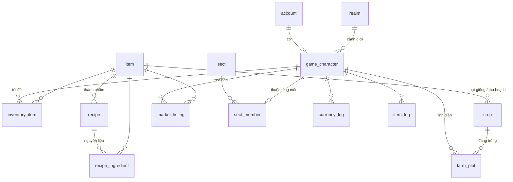

# Thiết kế Database: Linh Điền Ký (MVP)

## Nguyên tắc
- **Dữ liệu tĩnh** (cảnh giới, vật phẩm, cây trồng, công thức): game designer định nghĩa, nạp bằng migration. Người chơi không sửa được.
- **Dữ liệu người chơi** (nhân vật, túi đồ, ruộng, chợ): thay đổi liên tục trong lúc chơi.
- **Không lưu trong DB:** refresh token, Thiên bảng, session online → **Redis**.
- Tiền và vật phẩm **luôn** đổi trong transaction, và **luôn** ghi log (phục vụ chống dupe, tra soát).
- Bảng có nhiều người tranh nhau sửa (`character`, `market_listing`) có cột `version` để dùng optimistic lock.
- Tên bảng và cột đặt theo `snake_case`, số ít. Thời gian dùng `TIMESTAMPTZ`.

## Sơ đồ quan hệ

> Đặt tên `game_character` thay vì `character` vì `character` là từ khóa của SQL.

---

## A. Tài khoản

### `account`
| Cột | Kiểu | Ghi chú |
|---|---|---|
| id | BIGSERIAL PK | |
| username | VARCHAR(20) UNIQUE | không phân biệt hoa thường |
| email | VARCHAR(255) UNIQUE | |
| password_hash | VARCHAR(60) | BCrypt |
| role | VARCHAR(10) | USER / ADMIN |
| status | VARCHAR(10) | ACTIVE / BANNED |
| last_login_at | TIMESTAMPTZ | |
| created_at, updated_at | TIMESTAMPTZ | |

---

## B. Dữ liệu tĩnh

### `realm`: Cảnh giới
| Cột | Kiểu | Ghi chú |
|---|---|---|
| id | SMALLINT PK | 1 = Luyện Khí 1, 2 = Luyện Khí 2... |
| code | VARCHAR(30) UNIQUE | LUYEN_KHI_1 |
| name | VARCHAR(50) | Luyện Khí tầng 1 |
| major_stage | VARCHAR(20) | LUYEN_KHI / TRUC_CO / KIM_DAN |
| required_exp | BIGINT | tu vi cần có để đột phá lên tầng tiếp theo |
| breakthrough_rate | NUMERIC(5,4) | tỉ lệ đột phá, 0.8500 = 85% |
| base_hp, base_mp, base_atk, base_def | INT | chỉ số gốc |

### `item`: Định nghĩa vật phẩm
| Cột | Kiểu | Ghi chú |
|---|---|---|
| id | INT PK | |
| code | VARCHAR(50) UNIQUE | LINH_CHI_SEED |
| name | VARCHAR(100) | |
| type | VARCHAR(20) | SEED / HERB / PILL / MATERIAL / EQUIPMENT |
| rarity | VARCHAR(10) | COMMON / RARE / EPIC / LEGENDARY |
| max_stack | INT | 1 = không cộng dồn |
| base_price | BIGINT | giá bán cho NPC |
| tradable | BOOLEAN | được bán ở phường thị không |
| effect | JSONB | ví dụ đan dược: `{"exp": 500}`, `{"hp": 200}` |
| equip_slot | VARCHAR(15) NULL | chỉ có với EQUIPMENT: mặc vào vị trí nào |
| base_stats | JSONB NULL | chỉ số gốc trang bị: `{"atk": 50, "def": 10}` |
| required_realm_id | SMALLINT NULL | cảnh giới tối thiểu để dùng |
| description | TEXT | |

### `crop`: Cây trồng
| Cột | Kiểu | Ghi chú |
|---|---|---|
| id | INT PK | |
| seed_item_id | INT FK → item | hạt giống |
| harvest_item_id | INT FK → item | thứ thu được |
| grow_seconds | INT | thời gian lớn |
| yield_min, yield_max | INT | số lượng thu hoạch |
| required_realm_id | SMALLINT FK → realm | cảnh giới tối thiểu để trồng |

### `recipe`: Công thức luyện đan
| Cột | Kiểu | Ghi chú |
|---|---|---|
| id | INT PK | |
| code | VARCHAR(50) UNIQUE | |
| result_item_id | INT FK → item | |
| result_quantity | INT | |
| success_rate | NUMERIC(5,4) | |
| duration_seconds | INT | |
| required_realm_id | SMALLINT FK → realm | |

### `recipe_ingredient`
| Cột | Kiểu | Ghi chú |
|---|---|---|
| recipe_id | INT FK → recipe | PK (recipe_id, item_id) |
| item_id | INT FK → item | |
| quantity | INT | |

---

## C. Dữ liệu người chơi

### `game_character`: Nhân vật (mỗi tài khoản 1 nhân vật)
| Cột | Kiểu | Ghi chú |
|---|---|---|
| id | BIGSERIAL PK | |
| account_id | BIGINT FK → account, UNIQUE | |
| name | VARCHAR(20) UNIQUE | |
| realm_id | SMALLINT FK → realm | |
| exp | BIGINT | tu vi hiện tại |
| spirit_stone | BIGINT CHECK ≥ 0 | linh thạch (tiền) |
| hp, mp | INT | |
| map_id | VARCHAR(30) | map đang đứng |
| pos_x, pos_y | REAL | |
| story_chapter | SMALLINT | chương cốt truyện |
| pk_mode | VARCHAR(10) | PEACE / SECT / ALL: chế độ PK |
| pk_points | INT | sát khí: giết người tăng, theo thời gian giảm |
| version | BIGINT | optimistic lock |
| created_at, updated_at | TIMESTAMPTZ | |

### `inventory_item`: Túi đồ + trang bị
Một bảng chứa cả vật phẩm cộng dồn (đan, linh thảo) **và** trang bị riêng lẻ (mỗi món có chỉ số khác nhau).

| Cột | Kiểu | Ghi chú |
|---|---|---|
| id | BIGSERIAL PK | |
| character_id | BIGINT FK → game_character | |
| item_id | INT FK → item | |
| quantity | INT CHECK > 0 | trang bị luôn = 1 |
| slot_index | SMALLINT NULL | vị trí trong túi; NULL nếu đang mặc |
| equipped_slot | VARCHAR(15) NULL | WEAPON / ARMOR / HELMET / BOOTS / RING / AMULET; NULL = không mặc |
| enhance_level | SMALLINT DEFAULT 0 | cấp cường hóa (+1, +2...) |
| bonus_stats | JSONB NULL | chỉ số random riêng: `{"atk": 12, "crit": 0.02}` |
| bound | BOOLEAN DEFAULT false | khóa: không giao dịch được |
| created_at | TIMESTAMPTZ | |

Ràng buộc:
- UNIQUE (character_id, slot_index) WHERE slot_index IS NOT NULL
- UNIQUE (character_id, equipped_slot) WHERE equipped_slot IS NOT NULL: mỗi vị trí chỉ mặc 1 món

### `farm_plot`: Ô linh điền
| Cột | Kiểu | Ghi chú |
|---|---|---|
| id | BIGSERIAL PK | |
| character_id | BIGINT FK | UNIQUE (character_id, plot_index) |
| plot_index | SMALLINT | ô số mấy |
| crop_id | INT FK → crop, NULL | NULL = ô trống |
| planted_at | TIMESTAMPTZ | |
| ready_at | TIMESTAMPTZ | planted_at + grow_seconds |

> Không cần cột `status`: trạng thái tính từ dữ liệu (`crop_id` NULL thì ô trống; `now() < ready_at` thì cây đang lớn; còn lại là đã chín). Tránh lưu dữ liệu dư thừa.

### `market_listing`: Phường thị
| Cột | Kiểu | Ghi chú |
|---|---|---|
| id | BIGSERIAL PK | |
| seller_id | BIGINT FK → game_character | |
| buyer_id | BIGINT FK, NULL | |
| item_id | INT FK → item | |
| quantity | INT | |
| unit_price | BIGINT | |
| item_data | JSONB NULL | chỉ số trang bị (enhance_level, bonus_stats) của món đang bán |
| status | VARCHAR(10) | ACTIVE / SOLD / CANCELLED / EXPIRED |
| version | BIGINT | chống 2 người cùng mua |
| created_at, expires_at, closed_at | TIMESTAMPTZ | closed_at: lúc bán / hủy / hết hạn |

> Khi treo bán, vật phẩm bị lấy ra khỏi túi người bán (giữ hộ), nên không thể bán một món 2 lần.

Index: `(status, item_id)` để lọc hàng đang bán.

### `sect`: Tông môn
| Cột | Kiểu | Ghi chú |
|---|---|---|
| id | BIGSERIAL PK | |
| name | VARCHAR(30) UNIQUE | |
| leader_id | BIGINT FK → game_character | |
| level | SMALLINT | |
| contribution_pool | BIGINT | |
| created_at | TIMESTAMPTZ | |

### `sect_member`
| Cột | Kiểu | Ghi chú |
|---|---|---|
| character_id | BIGINT PK, FK | mỗi người chỉ thuộc 1 tông môn |
| sect_id | BIGINT FK → sect | |
| rank | VARCHAR(10) | LEADER / ELDER / MEMBER |
| contribution | BIGINT | |
| joined_at | TIMESTAMPTZ | |

---

## D. Log (chỉ thêm, không sửa, không xóa)

### `currency_log`
| Cột | Kiểu | Ghi chú |
|---|---|---|
| id | BIGSERIAL PK | |
| character_id | BIGINT | |
| amount | BIGINT | âm = trừ, dương = cộng |
| balance_after | BIGINT | số dư sau giao dịch |
| reason | VARCHAR(30) | MARKET_BUY / NPC_SELL / ALCHEMY... |
| ref_id | BIGINT | id của listing / recipe liên quan |
| created_at | TIMESTAMPTZ | |

### `item_log`
Cấu trúc giống `currency_log`, thêm cột `item_id`, còn `amount` là số lượng vật phẩm.

---

## E. Chiến đấu (đánh quái, kỹ năng)

> **Trận đánh diễn ra trong RAM của game-server**: vị trí quái, máu quái, cooldown skill, buff đều **không** lưu DB.
> DB chỉ lưu **định nghĩa** (quái gì, rơi gì) và **kết quả** (nhận exp, nhặt đồ).

### `skill`: Định nghĩa kỹ năng (tĩnh)
| Cột | Kiểu | Ghi chú |
|---|---|---|
| id | INT PK | |
| code | VARCHAR(50) UNIQUE | |
| name | VARCHAR(50) | |
| type | VARCHAR(10) | ACTIVE / PASSIVE |
| target | VARCHAR(10) | SELF / SINGLE / AOE |
| mp_cost | INT | |
| cooldown_ms | INT | |
| cast_range | REAL | |
| max_level | SMALLINT | |
| effect | JSONB | `{"damage_ratio": 1.5, "per_level": 0.1}` |
| required_realm_id | SMALLINT FK | |

### `character_skill`
| Cột | Kiểu | Ghi chú |
|---|---|---|
| character_id | BIGINT FK | PK (character_id, skill_id) |
| skill_id | INT FK | |
| level | SMALLINT | |
| hotbar_slot | SMALLINT NULL | ô phím tắt 1–8 |

### `monster`: Định nghĩa quái (tĩnh)
| Cột | Kiểu | Ghi chú |
|---|---|---|
| id | INT PK | |
| code | VARCHAR(50) UNIQUE | |
| name | VARCHAR(50) | |
| type | VARCHAR(10) | NORMAL / ELITE / BOSS |
| level | SMALLINT | |
| hp, atk, def | INT | |
| exp_reward | INT | |
| stone_min, stone_max | INT | linh thạch rơi ra |
| respawn_seconds | INT | |
| ai_type | VARCHAR(20) | PASSIVE / AGGRESSIVE / RANGED |

### `monster_drop`: Bảng rơi đồ (tĩnh)
| Cột | Kiểu | Ghi chú |
|---|---|---|
| monster_id | INT FK | PK (monster_id, item_id) |
| item_id | INT FK | |
| drop_rate | NUMERIC(6,5) | 0.05000 = 5% |
| quantity_min, quantity_max | INT | |

### Vị trí quái trên map
Không để trong DB. Map vẽ bằng **Tiled**, xuất JSON vào `game-server/src/main/resources/maps/`, trong đó có layer "spawn" ghi điểm xuất hiện và `monster_code`. Như vậy chỉnh map không cần migration.

### `world_boss_schedule`: Boss theo giờ (tĩnh)
| Cột | Kiểu | Ghi chú |
|---|---|---|
| id | INT PK | |
| monster_id | INT FK | |
| map_id | VARCHAR(30) | |
| cron | VARCHAR(50) | `0 0 20 * * *` = 20h hằng ngày |

---

## F. Ải / Bí cảnh (PvE theo màn)

### `dungeon`: Bí cảnh (tĩnh)
| Cột | Kiểu | Ghi chú |
|---|---|---|
| id | INT PK | |
| code | VARCHAR(50) UNIQUE | |
| name | VARCHAR(50) | |
| type | VARCHAR(10) | SOLO / PARTY |
| max_players | SMALLINT | |
| daily_limit | SMALLINT | số lượt mỗi ngày |
| required_realm_id | SMALLINT FK | |
| map_id | VARCHAR(30) | map instance |

### `dungeon_stage`: Các ải trong bí cảnh (tĩnh)
| Cột | Kiểu | Ghi chú |
|---|---|---|
| id | INT PK | |
| dungeon_id | INT FK | UNIQUE (dungeon_id, stage_no) |
| stage_no | SMALLINT | ải 1, 2, 3... |
| monsters | JSONB | `[{"monster": "SOI_XAM", "count": 5}, ...]` |
| time_limit_seconds | INT | |
| first_clear_reward | JSONB | `{"items": [...], "stone": 500}` |
| reward | JSONB | thưởng các lần sau |

### `character_dungeon`: Tiến độ người chơi
| Cột | Kiểu | Ghi chú |
|---|---|---|
| character_id | BIGINT FK | PK (character_id, dungeon_id) |
| dungeon_id | INT FK | |
| highest_stage | SMALLINT | ải cao nhất đã qua |
| best_time_ms | INT | |
| attempts_today | SMALLINT | reset mỗi ngày (cron) |
| last_attempt_at | TIMESTAMPTZ | |

---

## G. PK (PvP)

### PK ngoài map
- Chế độ PK lưu ở `game_character.pk_mode`, sát khí ở `pk_points`.
- Xử lý trong game-server; chỉ ghi lại kết quả:

### `pk_log`
| Cột | Kiểu | Ghi chú |
|---|---|---|
| id | BIGSERIAL PK | |
| killer_id | BIGINT FK | |
| victim_id | BIGINT FK | |
| map_id | VARCHAR(30) | |
| dropped_items | JSONB NULL | đồ rơi khi chết (nếu có luật rơi đồ) |
| created_at | TIMESTAMPTZ | |

### Đấu trường (xếp hạng)
### `arena_season` (tĩnh/quản trị)
| Cột | Kiểu | Ghi chú |
|---|---|---|
| id | INT PK | |
| name | VARCHAR(50) | |
| start_at, end_at | TIMESTAMPTZ | |
| rewards | JSONB | thưởng theo hạng |

### `arena_rating`
| Cột | Kiểu | Ghi chú |
|---|---|---|
| season_id | INT FK | PK (season_id, character_id) |
| character_id | BIGINT FK | |
| rating | INT DEFAULT 1000 | điểm ELO |
| wins, losses | INT | |

### `arena_match`
| Cột | Kiểu | Ghi chú |
|---|---|---|
| id | BIGSERIAL PK | |
| season_id | INT FK | |
| player1_id, player2_id | BIGINT FK | |
| winner_id | BIGINT NULL | NULL = hòa |
| rating_change | INT | |
| duration_ms | INT | |
| created_at | TIMESTAMPTZ | |

> Bảng xếp hạng realtime dùng Redis sorted set; DB là bản lưu chính thức.

---

## H. Nhiệm vụ

### `quest` (tĩnh)
| Cột | Kiểu | Ghi chú |
|---|---|---|
| id | INT PK | |
| code | VARCHAR(50) UNIQUE | |
| name | VARCHAR(100) | |
| type | VARCHAR(10) | MAIN / SIDE / DAILY |
| chapter | SMALLINT NULL | nhiệm vụ chính thuộc chương nào |
| prev_quest_id | INT NULL FK | phải xong nhiệm vụ trước |
| objectives | JSONB | `[{"type": "KILL", "target": "SOI_XAM", "count": 10}, {"type": "HARVEST", "target": "LINH_CHI", "count": 5}]` |
| rewards | JSONB | |
| required_realm_id | SMALLINT NULL | |

### `character_quest`
| Cột | Kiểu | Ghi chú |
|---|---|---|
| character_id | BIGINT FK | PK (character_id, quest_id) |
| quest_id | INT FK | |
| status | VARCHAR(10) | IN_PROGRESS / COMPLETED / CLAIMED |
| progress | JSONB | `[3, 5]` tiến độ từng mục tiêu |
| accepted_at, completed_at | TIMESTAMPTZ | |

---

## I. Xã hội

### `party` và `party_member`
Tổ đội tồn tại khi người chơi online → lưu trong **Redis / RAM game-server**, không cần DB.

### `friendship`
| Cột | Kiểu | Ghi chú |
|---|---|---|
| character_id | BIGINT FK | PK (character_id, friend_id) |
| friend_id | BIGINT FK | |
| status | VARCHAR(10) | PENDING / ACCEPTED / BLOCKED |
| created_at | TIMESTAMPTZ | |

### `mail`: Thư hệ thống / quà
| Cột | Kiểu | Ghi chú |
|---|---|---|
| id | BIGSERIAL PK | |
| receiver_id | BIGINT FK | |
| sender_id | BIGINT NULL | NULL = hệ thống |
| title | VARCHAR(100) | |
| content | TEXT | |
| attachments | JSONB NULL | `{"items": [...], "stone": 1000}` |
| is_read | BOOLEAN | |
| claimed_at | TIMESTAMPTZ NULL | |
| expires_at | TIMESTAMPTZ | |
| created_at | TIMESTAMPTZ | |

### Chat
Kênh thế giới, tông môn, tổ đội đi qua game-server (realtime). Nếu cần lưu lịch sử để kiểm duyệt, thêm `chat_log` sau.

---

## J. Cái gì để ở đâu

| Dữ liệu | Nơi lưu | Lý do |
|---|---|---|
| Định nghĩa game (item, quái, skill, ải, quest) | PostgreSQL (migration seed) | ít đổi, cần quan hệ |
| Tài sản người chơi (đồ, tiền, tiến độ) | PostgreSQL | không được mất |
| Quái đang sống, máu, vị trí, buff, cooldown | RAM game-server | đổi 20 lần/giây |
| Session online, tổ đội, refresh token | Redis | tạm thời, có TTL |
| Bảng xếp hạng realtime | Redis sorted set | đọc/ghi liên tục |
| Map, điểm spawn | File JSON (Tiled) | designer chỉnh dễ |
| Log PK, giao dịch | PostgreSQL | tra soát |

---

## Lộ trình migration

| File | Nội dung | Giai đoạn |
|---|---|---|
| V1__create_account.sql | account | Auth |
| V2__create_static_data.sql | realm, item, crop, recipe, recipe_ingredient | Nhân vật |
| V3__seed_static_data.sql | dữ liệu cảnh giới, vật phẩm, cây, công thức | Nhân vật |
| V4__create_character.sql | game_character | Nhân vật |
| V5__create_inventory_and_logs.sql | inventory_item, currency_log, item_log | Túi đồ |
| V6__create_farm.sql | farm_plot | Linh điền |
| V7__create_market.sql | market_listing | Phường thị |
| V8__create_combat_data.sql | skill, character_skill, monster, monster_drop, world_boss_schedule | Game server, đánh quái |
| V9__create_dungeon.sql | dungeon, dungeon_stage, character_dungeon | Bí cảnh |
| V10__create_quest.sql | quest, character_quest | Nhiệm vụ |
| V11__create_pvp.sql | pk_log, arena_season, arena_rating, arena_match | PK |
| V12__create_social.sql | sect, sect_member, friendship, mail | Xã hội |

Đã thiết kế trước toàn bộ, nhưng **mỗi migration chỉ viết khi làm tới giai đoạn đó**. Cần thêm cột thì tạo file V mới, không sửa file cũ.
